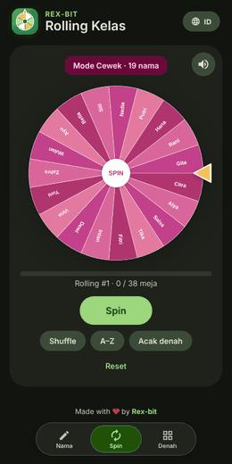

# Rolling Kelas · Rex-bit

Web rolling tempat duduk kelas: tempel daftar nama, putar roda, dan nama yang keluar otomatis mengisi meja.

## Fitur
- **Satu daftar campur**: tempel semua nama, cowok dan cewek otomatis dipisah. Bisa juga ditandai `(L)` / `(P)`, dan nama yang salah tebak tinggal diketuk untuk dipindah.
- **Spin wheel** ala Wheel of Names: pointer di kanan, suara tik saat berputar, fanfare dan konfeti saat nama keluar. Ada tombol suara on/off.
- **Shuffle** dan **A–Z** untuk mengatur urutan nama di roda. **Acak denah** mengisi semua meja sekaligus.
- **Denah 38 meja**: kiri 10 (5 baris x 2), tengah 18 (6 saf x 3), kanan 10 (5 baris x 2).
- **Dua pola denah**: **Selang-seling** (dalam satu baris meja bergantian cowok, cewek, cowok…, urutannya diacak tiap baris) dan **Acak Penuh** (setiap baris hanya berisi satu jenis, susunan barisnya diacak). Jumlah kursi cowok/cewek mengikuti jumlah nama. Tombol **Acak Ulang Pola** di tab Denah menyusun ulang polanya.
- **Rolling berikutnya**: setelah semua meja terisi muncul popup. Rolling berikutnya membuat denah baru (pola baris diacak ulang) dan denah lama tersimpan di riwayat tab Denah.
- **2 bahasa**: English dan Bahasa Indonesia, ganti lewat tombol di pojok kanan atas.
- Data tersimpan di browser (localStorage).

## Tampilan
- **Layout laptop/desktop** ala Wheel of Names: roda besar di kiri, panel **Nama / Denah** di kanan. Di HP tetap memakai tab bar di bawah.
- Gaya **Material You** (Material 3) bernuansa hijau, otomatis mode terang/gelap.
- **Liquid glass tab bar**: bar tembus pandang. Saat ditekan, hanya pill hijaunya yang membesar. Pill bisa digeser dengan jari dan melar saat pindah tab. Murni CSS + pointer events (stabil di Safari iPhone).

## Jalankan
Buka `index.html` di browser. Tidak perlu build.

## Fitur tambahan
- Roda berputar pelan sendiri sebelum spin pertama
- Header otomatis sembunyi saat scroll ke bawah, muncul lagi saat scroll ke atas
- FAQ + Kebijakan Privasi ("Apakah data saya privat?") dan tombol hapus semua data
- Ekspor denah: salin teks, simpan PNG, cetak
- Spasi untuk memutar, tombol layar penuh
- Pengaturan (ala wheelofnames): suara putaran/pemenang, volume, durasi, konfeti, popup, warna roda, latar gradien
- Konfeti gradien (hijau, biru, pink, emas, putih)
- Mode Fokus (hanya roda) dan tombol Urungkan (Ctrl+Z)
